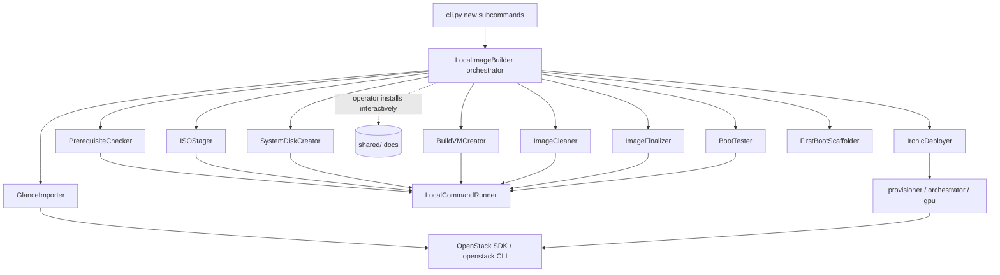

# Design Document

## Overview

This design adds a **local KVM/libvirt build path** to the `proxmox_install_automation` package. The new path builds a generic, reusable Proxmox VE qcow2 image end to end on a local Debian/Ubuntu build host, then imports it into OpenStack Glance and deploys it to an Ironic bare-metal node, followed by first-boot configuration scaffolding.

The design follows the established patterns of the existing codebase:

- **Dataclass configs and results** mirroring `ImageBuildConfig` / `ImageBuildResult` in `image_builder/models.py`.
- **A single orchestrator class** that sequences discrete step components with `try/finally` cleanup, mirroring `ImageBuilder.build()` and `ProxmoxBuilder.run()`.
- **Thin, mockable subprocess wrappers** for each external tool (`qemu-img`, `virt-install`, `virsh`, `openstack`), mirroring how `ISOConverter` wraps `qemu-img` over an injected transport.
- **Module-scoped exceptions** that extend `ProxmoxAutomationError`, mirroring `image_builder/exceptions.py`.
- **New Click subcommands** registered on the existing `main` group in `cli.py`, consistent with `install` and `build-image`.

The existing remote OpenStack-instance `image_builder` flow and the `build-image` CLI command are preserved unchanged (Requirement 1). The new path lives in a new sibling package, `local_build`, so no existing public interface is modified.

### Design Principles

1. **Non-invasive addition.** Nothing in `image_builder/` is edited; the local path is additive (Req 1.1, 1.3).
2. **Local-first execution.** All build commands run on the Local_Build_Host via a `LocalCommandRunner` (a `subprocess` wrapper), in contrast to the existing remote flow that runs commands over SSH.
3. **Reuse the deploy stack.** The Ironic deploy phase reuses `auth`, `provisioner`, `orchestrator`, and `gpu` modules (Req 11.3).
4. **Documented interactive install.** The Proxmox install itself is interactive and documented, not automated (Req 6); the orchestrator pauses for operator confirmation between the "VM created" and "cleaning" phases.
5. **Fail fast with non-zero exit codes.** Every stage raises a typed exception on failure; the CLI maps success to exit code 0 and any failure to a non-zero code (Req 14.2).

### Language and Tooling

- **Language:** Python 3 (dominant language of the repository).
- **CLI framework:** Click (existing dependency).
- **Testing:** `pytest` for unit/example tests, `hypothesis` for property-based tests, `unittest.mock` for mocking the command runner and OpenStack SDK.

## Architecture

### Package Layout

The local build path is added as a new package alongside `image_builder/`:

```
proxmox_install_automation/
├── cli.py                       # EXISTING — add new subcommands only
├── image_builder/               # EXISTING — unchanged (Req 1.3)
├── provisioner/                 # EXISTING — reused by Ironic deploy (Req 11.3)
├── orchestrator/                # EXISTING — reused by Ironic deploy (Req 11.3)
├── gpu/                         # EXISTING — reused by Ironic deploy (Req 11.3)
└── local_build/                 # NEW
    ├── __init__.py              # public exports
    ├── models.py                # dataclass configs + results
    ├── exceptions.py            # typed errors extending ProxmoxAutomationError
    ├── command_runner.py        # LocalCommandRunner (subprocess wrapper, mockable)
    ├── prerequisites.py         # PrerequisiteChecker          (Req 2)
    ├── iso_stager.py            # ISOStager                    (Req 3)
    ├── system_disk.py           # SystemDiskCreator            (Req 4)
    ├── build_vm.py              # BuildVMCreator               (Req 5)
    ├── image_cleaner.py         # ImageCleaner                 (Req 7)
    ├── image_finalizer.py       # ImageFinalizer               (Req 8)
    ├── boot_tester.py           # BootTester                   (Req 9)
    ├── glance_importer.py       # GlanceImporter               (Req 10)
    ├── ironic_deployer.py       # IronicDeployer               (Req 11)
    ├── firstboot_scaffolder.py  # FirstBootScaffolder          (Req 12)
    ├── config_loader.py         # load_local_build_config (YAML)
    ├── config_validator.py      # LocalBuildConfigValidator
    └── builder.py               # LocalImageBuilder (orchestrator)
```

### Component Diagram



### Build Pipeline Sequence

```mermaid
sequenceDiagram
    participant Op as Operator
    participant CLI
    participant B as LocalImageBuilder
    participant R as LocalCommandRunner

    Op->>CLI: local-build run --config cfg.yaml
    CLI->>B: build(config)
    B->>R: PrerequisiteChecker (Req 2)
    B->>R: ISOStager (Req 3)
    B->>R: SystemDiskCreator qemu-img create 64G (Req 4)
    B->>R: BuildVMCreator virt-install (Req 5)
    B-->>Op: PAUSE — perform documented interactive install (Req 6)
    Op-->>B: confirm install complete
    B->>R: ImageCleaner (Req 7)
    B->>R: ImageFinalizer virsh undefine --nvram; qemu-img check/info; convert -c (Req 8)
    B->>R: BootTester virt-install --import, parse console (Req 9)
    B->>CLI: ImageBuildArtifact(final_image_path)
```

The deploy phase (Glance import → Ironic deploy → first-boot scaffolding) is a separate subcommand so operators can build once and deploy to many nodes (the image is generic by design, Req 13).

## Components and Interfaces

All configs and results are frozen-friendly dataclasses consistent with `image_builder/models.py`. Each step component exposes a small, mockable interface and raises a typed exception on failure.

### Command Runner (subprocess wrapper)

A single injectable wrapper isolates all local shell execution so that every tool-invoking component is unit-testable by mocking one object. This mirrors how `ISOConverter` depends on an injected `SSHConnection`.

```python
@dataclass
class CommandResult:
    argv: list[str]
    exit_code: int
    stdout: str
    stderr: str
    duration_seconds: float


class LocalCommandRunner:
    """Thin, mockable wrapper over subprocess for local tool execution."""

    def run(
        self,
        argv: list[str],
        timeout: int | None = None,
        check: bool = True,
    ) -> CommandResult:
        """Run argv as a list (no shell), capturing output.

        Uses argv lists (never shell string interpolation) to avoid
        command injection. Raises LocalCommandError if check=True and
        the exit code is non-zero, or on timeout.
        """
```

**Testing approach for shell commands:** Components build an `argv` list via a pure helper (e.g. `build_virt_install_argv(config)`), then pass it to `runner.run(argv)`. Tests assert on the generated `argv` (pure, deterministic) and mock `LocalCommandRunner.run` to simulate success, non-zero exit, and timeout. No real `qemu-img`/`virt-install`/`virsh`/`openstack` process is spawned in unit tests. For guest-filesystem cleaning, the `ImageCleaner` builds a plan of operations applied via `virt-customize`/`guestfish` (libguestfs); the plan is a pure data structure that tests assert against, and execution is a single mocked runner call.

### Configuration and Result Models (`local_build/models.py`)

```python
@dataclass
class LocalBuildConfig:
    """Configuration for the local KVM/libvirt build path."""

    # ISO staging (Req 3)
    iso_source_path: str
    architecture: str = "x86_64"          # x86_64 | amd64 | arm64
    libvirt_images_dir: str = "/var/lib/libvirt/images"

    # System disk (Req 4)
    system_disk_size_gb: int = 64
    system_disk_name: str = "proxmox-image-builder.qcow2"

    # Build VM (Req 5)
    build_vm_name: str = "proxmox-image-builder"
    vcpus: int = 8
    ram_mib: int = 16384                  # 16 GB
    cpu_mode: str = "host-passthrough"
    network_model: str = "virtio"
    disk_bus: str = "virtio"

    # Finalization (Req 8)
    final_image_name: str = "proxmox-opcp-final.qcow2"
    output_dir: str = "/var/lib/libvirt/images"

    # Timeouts
    build_timeout: int = 3600
    convert_timeout: int = 1800
    boot_test_timeout: int = 600

    # Interactive gate (Req 6)
    assume_install_complete: bool = False  # skip the operator pause


@dataclass
class DeployConfig:
    """Configuration for Glance import + Ironic deploy + first-boot (Req 10-12)."""

    final_image_path: str
    glance_image_name: str
    credentials: Credentials               # reuses proxmox_install_automation.models
    ironic_node: str
    bare_metal_flavor: str
    network_name: str = "Ext-Net"
    glance_timeout: int = 1800
    deploy_timeout: int = 3600
    firstboot_format: str = "cloud-init"   # cloud-init | systemd | ansible
    firstboot_output_dir: str = "./firstboot"


@dataclass
class ImageBuildArtifact:
    """Result of a successful local image build."""

    final_image_path: str
    virtual_size_bytes: int
    actual_size_bytes: int
    build_duration_seconds: float
    boot_test_passed: bool


@dataclass
class DeployResult:
    """Result of a successful Glance import + Ironic deploy."""

    glance_image_id: str
    server_id: str
    ironic_node: str
    firstboot_artifacts: list[str]
    deploy_duration_seconds: float


@dataclass
class PrerequisiteReport:
    """Aggregate result of the prerequisite checks (Req 2)."""

    os_supported: bool
    missing_packages: list[str]
    kvm_available: bool
    uefi_available: bool

    @property
    def ok(self) -> bool:
        return (
            self.os_supported
            and not self.missing_packages
            and self.kvm_available
            and self.uefi_available
        )
```

### PrerequisiteChecker (Requirement 2)

```python
REQUIRED_PACKAGES = (
    "qemu-utils", "qemu-system-x86", "libvirt-daemon-system",
    "libvirt-clients", "virtinst", "ovmf",
)

class PrerequisiteChecker:
    def __init__(self, runner: LocalCommandRunner): ...

    def check(self) -> PrerequisiteReport:
        """Verify OS family, required packages, KVM accel, OVMF firmware.

        Returns an aggregate report. The orchestrator raises
        PrerequisiteError (non-zero exit via CLI) if report.ok is False.
        """

    def detect_os_family(self, os_release: dict[str, str]) -> bool:
        """Pure: True iff ID or ID_LIKE indicates debian/ubuntu lineage."""

    def compute_missing_packages(self, installed: set[str]) -> list[str]:
        """Pure: REQUIRED_PACKAGES not present in `installed`."""
```

- OS family detection reads `/etc/os-release` (parsed to a dict, then classified by the pure `detect_os_family`). (Req 2.1)
- Package presence probed via `dpkg-query`; missing set computed by the pure `compute_missing_packages`. (Req 2.2)
- KVM via `/dev/kvm` presence / `kvm-ok`. (Req 2.3)
- OVMF via presence of the firmware descriptor (e.g. `/usr/share/OVMF/OVMF_CODE.fd`). (Req 2.4)
- Any failure → `PrerequisiteError` with the specific missing item; CLI exits non-zero. (Req 2.5)

### ISOStager (Requirement 3)

```python
ISO_BY_ARCH = {
    "x86_64": "amd64",
    "amd64":  "amd64",
    "arm64":  "arm64",
}

class ISOStager:
    def __init__(self, runner: LocalCommandRunner): ...

    def select_iso(self, architecture: str, available: dict[str, str]) -> str:
        """Pure: map architecture family to the ISO entry (Req 3.3, 3.4)."""

    def stage(self, config: LocalBuildConfig) -> str:
        """Copy ISO into libvirt_images_dir, set libvirt-readable
        ownership/permissions, return staged path (Req 3.1, 3.2).
        Raises ISOStagingError if the source ISO is absent (Req 3.5).
        """
```

### SystemDiskCreator (Requirement 4)

```python
class SystemDiskCreator:
    def build_argv(self, path: str, size_gb: int) -> list[str]:
        """Pure: ['qemu-img', 'create', '-f', 'qcow2', path, f'{size_gb}G']."""

    def create(self, config: LocalBuildConfig) -> str:
        """Create the 64GB qcow2 system disk independent of data disks
        (Req 4.1, 4.2). Raises SystemDiskError on failure (Req 4.3)."""
```

### BuildVMCreator (Requirement 5)

```python
class BuildVMCreator:
    def build_argv(self, config: LocalBuildConfig, iso_path: str, disk_path: str) -> list[str]:
        """Pure: full virt-install argv.

        Guarantees presence of: --name proxmox-image-builder,
        --vcpus 8, --memory 16384, --cpu host-passthrough,
        --boot uefi (OVMF loader), --disk bus=virtio (System_Disk),
        --network model=virtio, --cdrom <staged ISO> (Req 5.1, 5.2).
        """

    def create(self, config, iso_path, disk_path) -> None:
        """Invoke virt-install. Raises BuildVMError on failure (Req 5.3)."""
```

### Documented Interactive Install (Requirement 6)

No executable component. The orchestrator pauses (unless `assume_install_complete`) and points the operator to the documented steps in `shared/`. The documentation covers UEFI boot, GPT partitioning, ext4/LVM layout (EFI + LVM root/swap/data), VirtIO disk, explicit avoidance of ZFS, and a clear statement that the install is interactive and not automated (Req 6.1–6.3).

### ImageCleaner (Requirement 7)

The cleaner builds a **cleaning plan** (a pure data structure listing the operations) and applies it to the installed guest disk via libguestfs (`virt-customize`/`guestfish`). Modeling the plan as data makes the generic-ization behavior property-testable without a real guest.

```python
@dataclass
class CleaningPlan:
    operations: list[CleaningOp]          # ordered, declarative

class ImageCleaner:
    def build_plan(self) -> CleaningPlan:
        """Pure. Produces operations that:
          - write loopback-only /etc/network/interfaces   (7.1)
          - set hostname to 'pve-template'                (7.2)
          - remove SSH host keys                          (7.3)
          - reset machine-id, recreate dbus symlink       (7.4)
          - remove DHCP lease files                       (7.5)
          - rotate/vacuum journal, remove archived logs   (7.6)
          - run apt clean                                 (7.7)
        The plan NEVER touches/retains cluster, Corosync,
        Ceph, or shared-storage config and removes any present (7.8).
        """

    def apply(self, disk_path: str, plan: CleaningPlan) -> None:
        """Apply via libguestfs. Raises ImageCleanError on failure."""
```

### ImageFinalizer (Requirement 8)

```python
class ImageFinalizer:
    def build_undefine_argv(self, vm_name: str) -> list[str]:
        """Pure: ['virsh', 'undefine', vm_name, '--nvram']  (Req 8.2).
        Never includes storage-removal flags for the System_Disk."""

    def build_convert_argv(self, src: str, dst: str) -> list[str]:
        """Pure: ['qemu-img','convert','-O','qcow2','-c',src,dst] (Req 8.4)."""

    def shutdown(self, vm_name: str) -> None:
        """virsh shutdown + wait for shut-off (Req 8.1)."""

    def finalize(self, config: LocalBuildConfig, disk_path: str) -> ImageBuildArtifact:
        """Undefine --nvram (8.2) → qemu-img check + info validation (8.3)
        → compress to proxmox-opcp-final.qcow2 (8.4). Raises
        ImageFinalizeError if validation fails (8.5)."""
```

### BootTester (Requirement 9)

```python
BOOT_MARKERS = ("UEFI", "GRUB", "Linux", "Proxmox VE")  # ordered sequence

class BootTester:
    def build_argv(self, image_path: str, config: LocalBuildConfig) -> list[str]:
        """Pure: virt-install --import argv. Contains --import and
        NEVER a --cdrom / ISO attachment (Req 9.1)."""

    def detect_boot_sequence(self, console_log: str) -> bool:
        """Pure: True iff BOOT_MARKERS appear in order (Req 9.2)."""

    def run(self, image_path: str, config: LocalBuildConfig) -> bool:
        """Import-boot the final image, capture serial console, confirm
        UEFI→GRUB→kernel→Proxmox VE. Raises BootTestError if the
        sequence is not reached (Req 9.3)."""
```

### GlanceImporter (Requirement 10)

Uses the OpenStack SDK / `openstack` CLI (same auth as the existing flow via `Credentials`).

```python
class GlanceImporter:
    def build_import_request(self, name: str, path: str) -> dict:
        """Pure: whole-disk request with disk_format='qcow2',
        container_format='bare'. NEVER contains 'kernel_id' or
        'ramdisk_id' keys (Req 10.1, 10.2)."""

    def import_image(self, config: DeployConfig) -> str:
        """Create the Glance image and wait for status 'active'
        (Req 10.3). Raises GlanceImportError on timeout (Req 10.4)."""
```

### IronicDeployer (Requirement 11)

Reuses the existing deploy stack: `auth.manager.OpenStackAuthManager`, `provisioner.instance.InstanceProvisioner`, `orchestrator`, and `gpu` modules where applicable (Req 11.3).

```python
class IronicDeployer:
    def configure_node(self, node: str) -> None:
        """Set Ironic node boot_mode=uefi (Req 11.1)."""

    def deploy(self, config: DeployConfig, glance_image_id: str) -> str:
        """Deploy via `openstack server create` using the imported image,
        reusing provisioner/orchestrator/gpu (Req 11.2, 11.3). Returns the
        server id. Raises IronicDeployError on failure (Req 11.4)."""
```

### FirstBootScaffolder (Requirement 12)

```python
REQUIRED_TOPICS = (
    "hostname", "ip_address", "dns", "ntp", "network_interfaces",
    "vmbr0_bridge", "bonds", "vlans", "storage_network",
    "cluster_corosync", "zfs_ceph",
)

class FirstBootScaffolder:
    def generate(self, config: DeployConfig) -> list[str]:
        """Generate cloud-init / systemd first-boot / Ansible artifacts
        containing a scaffolding section for every REQUIRED_TOPICS entry
        (Req 12.1, 12.2, 12.3). Returns written artifact paths."""
```

### CLI Integration (Requirement 14)

New subcommands registered on the existing `main` group in `cli.py`, consistent with `install` and `build-image`. The existing `build-image` and `install` commands are untouched (Req 1.1, 1.2).

```python
@main.group("local-build")
def local_build_group() -> None:
    """Local KVM/libvirt Proxmox image build and bare-metal deploy."""

@local_build_group.command("check")      # PrerequisiteChecker only
@local_build_group.command("run")        # full build → ImageBuildArtifact
@local_build_group.command("deploy")     # Glance import + Ironic + first-boot
```

Each handler loads YAML config, runs the orchestrator, prints a concise result, and uses `sys.exit(0)` on success / `sys.exit(1)` (or `2` for unexpected errors) on failure, exactly as `build-image` does today (Req 14.2, 14.3).

### Orchestrator (`local_build/builder.py`)

`LocalImageBuilder.build(config)` sequences prerequisites → ISO stage → system disk → build VM → (operator pause) → clean → finalize → boot test, with `try/finally` cleanup of the transient Build_VM, mirroring `ImageBuilder.build()`. `LocalImageBuilder.deploy(deploy_config)` sequences Glance import → Ironic deploy → first-boot scaffolding.

## Data Models

| Model | Purpose | Mirrors |
|-------|---------|---------|
| `LocalBuildConfig` | Build-phase inputs | `ImageBuildConfig` |
| `DeployConfig` | Deploy-phase inputs | `ImageBuildConfig` |
| `ImageBuildArtifact` | Build result | `ImageBuildResult` |
| `DeployResult` | Deploy result | `ImageBuildResult` |
| `PrerequisiteReport` | Prereq aggregate | — |
| `CleaningPlan` / `CleaningOp` | Declarative cleaning | — |
| `CommandResult` | Local command output | `ssh` result shape in `ISOConverter` |

## Error Handling

New exceptions live in `local_build/exceptions.py`, each extending `ProxmoxAutomationError` (consistent with `image_builder/exceptions.py`):

```python
class LocalBuildError(ProxmoxAutomationError): ...
class LocalCommandError(ProxmoxAutomationError): ...
class PrerequisiteError(ProxmoxAutomationError): ...
class ISOStagingError(ProxmoxAutomationError): ...
class SystemDiskError(ProxmoxAutomationError): ...
class BuildVMError(ProxmoxAutomationError): ...
class ImageCleanError(ProxmoxAutomationError): ...
class ImageFinalizeError(ProxmoxAutomationError): ...
class BootTestError(ProxmoxAutomationError): ...
class GlanceImportError(ProxmoxAutomationError): ...
class IronicDeployError(ProxmoxAutomationError): ...
class FirstBootScaffoldError(ProxmoxAutomationError): ...
```

Error-handling contract:

- Each stage raises its typed exception on failure, with a message naming the missing/failed resource.
- The orchestrator catches, logs, and re-raises as `LocalBuildError` when needed (mirroring `ImageBuilder.build`).
- `LocalCommandRunner.run(check=True)` raises `LocalCommandError` on non-zero exit or timeout; long-running tools (`qemu-img convert`, boot test) have explicit timeouts.
- The CLI maps any `ProxmoxAutomationError` to a non-zero exit code and success to `0` (Req 2.5, 3.5, 4.3, 5.3, 8.5, 9.3, 10.4, 11.4, 14.2).
- `try/finally` guarantees the transient Build_VM is cleaned up even on failure.

## Documentation Updates (Requirement 15)

The following `shared/` documents are updated to describe the local KVM/libvirt workflow end to end (prerequisites → ISO staging → disk/VM creation → documented interactive install → cleaning → finalization → boot test → Glance import → Ironic deploy → first-boot scaffolding) (Req 15.1, 15.2):

- `shared/SPECIFY_context.md` and `shared/MODIFY_CODE_context.md` — reference the new `local_build` package and subcommands.
- A new `shared/LOCAL_BUILD_context.md` — the full documented procedure, including the interactive install steps (Req 6) and the generic-image content policy (Req 13).
- `shared/README.md` — link to the new procedure.

## Testing Strategy

**Dual approach**, consistent with the repository:

- **Unit / example tests (pytest + mock):** presence of CLI subcommands and the preserved `build-image` command; argv builders for `qemu-img create`, `virt-install`, `virsh undefine --nvram`, `qemu-img convert -c`, boot-test `--import`; per-stage error paths (each stage raises its typed exception and the CLI returns non-zero); Glance create parameters; Ironic `boot_mode=uefi` and `server create`; cleaning plan contents; first-boot artifact validity.
- **Property tests (hypothesis, ≥100 iterations each):** the ten correctness properties below, each tagged `Feature: proxmox-qcow2-opcp-deployment, Property N`.
- **Integration tests (1–3 examples, out of scope for PBT):** real `openstack`/Ironic wiring and the binary-image content guarantee (Req 13.1) via a boot test and manifest check.

All external tools are invoked through `LocalCommandRunner` and the OpenStack SDK, both mocked in unit and property tests. Argv builders and plan builders are pure functions, so property tests exercise them directly without spawning processes.

## Correctness Properties

*A property is a characteristic or behavior that should hold true across all valid executions of a system — essentially, a formal statement about what the system should do. Properties serve as the bridge between human-readable specifications and machine-verifiable correctness guarantees.*

### Property 1: Existing image_builder public API is preserved

For all names exported by `image_builder.__all__` captured as a baseline, each name remains importable from `image_builder` with a compatible kind (class/function), so adding the local build path does not break the existing module interface.

**Validates: Requirements 1.3**

### Property 2: OS family detection correctness

For any `/etc/os-release` content, `detect_os_family` returns true if and only if the parsed `ID` or `ID_LIKE` indicates a Debian or Ubuntu lineage.

**Validates: Requirements 2.1**

### Property 3: Missing-package computation correctness

For any set of installed packages, `compute_missing_packages` returns exactly the required packages absent from the installed set, and the prerequisite result is package-ok if and only if that returned set is empty.

**Validates: Requirements 2.2, 2.5**

### Property 4: ISO architecture selection is a total mapping

For any supported architecture token (`x86_64`, `amd64`, or `arm64`), `select_iso` returns the ISO entry whose architecture family matches the token.

**Validates: Requirements 3.3, 3.4**

### Property 5: Build VM argv contains all mandated resources

For any `LocalBuildConfig`, the generated `virt-install` argv contains the name `proxmox-image-builder`, 8 vCPUs, 16384 MiB RAM, host CPU passthrough, UEFI boot, a VirtIO system disk, a VirtIO network interface, and the staged ISO attached as a CD-ROM.

**Validates: Requirements 5.1, 5.2**

### Property 6: Cleaning produces a generic image

For any modeled installed-image state (possibly containing host-specific identity and cluster/Corosync/Ceph/shared-storage artifacts), applying the cleaning plan yields a state with loopback-only `/etc/network/interfaces`, hostname `pve-template`, and no SSH host keys, machine-id, DHCP leases, archived logs, or cluster/Corosync/Ceph/shared-storage configuration remaining.

**Validates: Requirements 7.1, 7.2, 7.3, 7.4, 7.5, 7.6, 7.7, 7.8, 13.2**

### Property 7: Boot test imports without an ISO and detects the ordered sequence

For any `LocalBuildConfig`, the boot-test argv contains `--import` and never attaches a CD-ROM/ISO; and for any console log, the boot-sequence detector returns true if and only if the markers UEFI, GRUB, kernel, and Proxmox VE appear in that order.

**Validates: Requirements 9.1, 9.2**

### Property 8: Glance import request is whole-disk without kernel/ramdisk

For any image metadata input, the constructed Glance import request uses disk-format qcow2 and container-format bare and never contains a `kernel_id` or `ramdisk_id` key.

**Validates: Requirements 10.1, 10.2**

### Property 9: First-boot scaffolding covers all required topics

For any `DeployConfig`, the generated first-boot artifacts contain a scaffolding section for every required topic (hostname, IP address, DNS, NTP, network interfaces, vmbr0 bridge, bonds, VLANs, storage network, cluster/Corosync, and ZFS/Ceph).

**Validates: Requirements 12.2, 12.3**

### Property 10: CLI exit-code contract

For any command outcome, the CLI returns exit code 0 if and only if the outcome is a success; any failure outcome (a raised `ProxmoxAutomationError` subclass) maps to a non-zero exit code.

**Validates: Requirements 2.5, 3.5, 4.3, 5.3, 8.5, 9.3, 10.4, 11.4, 14.2**
